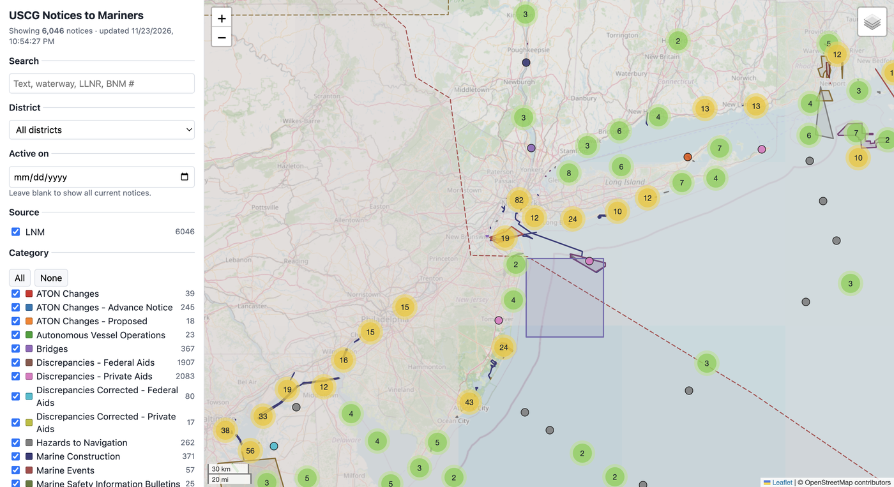

# USCG Notices to Mariners Map

Fetches U.S. Coast Guard Local Notices to Mariners (LNM) and puts them on a web map you can pan and zoom. Each notice's full text is shown in a popup on its geometry. It also maps Broadcast Notices to Mariners (BNM) received by email.



> **Disclaimer:** This utility is provided as is, with no warranty of any kind and no guarantee that it is complete, current or free of errors. Notices may be missing, delayed or misplaced. Using it for navigation is entirely at your own risk. Always check the official Coast Guard Notices to Mariners.

## How it works

```
cron (every 2 h) → bnm-fetch → <web dir>/index.html, app.js
                                <web dir>/data/notices.geojson, notices.kml, manifest.json
```

- **LNM:** `bnm-fetch` downloads the NAVCEN MSI GeoJSON files (`https://navcen.uscg.gov/sites/default/files/msi/*.geojson`). About 40 files cover every district and LNM category.
- **BNM:** NAVCEN's BNM search page and RSS feeds can't be read by scripts, so BNMs come from NAVCEN's official GovDelivery email subscriptions. A lab mailbox subscribes to them, and each run reads the recent messages over IMAP (read-only, nothing deleted or marked read) or from a local Maildir/mbox. Positions are parsed from the text: a single position becomes a point, "within N yards of" becomes a circle, "area bounded by" becomes a polygon, and a route becomes a line. `CANCEL AT//DDHHMMZ MON YY` sets the end time, and `CANCEL BNM nnnn-yy` removes the BNM it names. BNMs with no parseable position are listed in the map's side panel.
- It normalizes everything into one schema and drops expired notices. It writes GeoJSON and KML, then copies in the static map page.
- Downloads use conditional GET and are cached in `~/.cache/bnm`. If NAVCEN is down or returns bad data, the last good copy is used and the problem is reported in `manifest.json`. The map shows a warning banner when that happens.
- Notice data is never committed to git. GitHub holds only the code.

The map is Leaflet, with OpenStreetMap and an optional NOAA ENC chart overlay. You can filter by category, district, source and the date a notice is active, and search the text. The current view is kept in the URL (`#zoom/lat/lon`), so you can share a link to a specific area. `notices.kml` opens in Google Earth or OpenCPN.

## Server Installation

```bash
# Create the install and log directories, owned by the account that will run the fetcher
sudo mkdir -p /opt/bnm /var/log/bnm && sudo chown $USER /opt/bnm /var/log/bnm

# Get the code
git clone https://github.com/valschmidt/bnm.git /opt/bnm/src

# Create a private Python environment (Python 3.10 or newer) and install bnm-fetch into it
python3 -m venv /opt/bnm/venv
/opt/bnm/venv/bin/pip install /opt/bnm/src

# Copy the example config, then edit it: set `out` to the web directory the map is served from
cp /opt/bnm/src/bnm.toml.example /opt/bnm/bnm.toml

# Run once by hand to check everything works (takes about 30 s)
/opt/bnm/venv/bin/bnm-fetch -c /opt/bnm/bnm.toml -v

# Schedule it: paste in the line from deploy/crontab.example (runs every 2 hours)
crontab -e
```

There are also systemd units in `deploy/` (`bnm-fetch.service` and `bnm-fetch.timer`) if you prefer them to cron. If the web server is a different machine, set `rsync = "user@host:/path/"` in `bnm.toml`.

To update the code:

```bash
# Pull the latest code and reinstall it into the environment
git -C /opt/bnm/src pull && /opt/bnm/venv/bin/pip install /opt/bnm/src
```

### BNM mailbox

Broadcast Notices to Mariners are read out over marine radio and listed on NAVCEN's search web page, but that page blocks automated access. The only form a program can use is email: NAVCEN sends each BNM to email subscribers through GovDelivery. To put BNMs on the map you therefore need:

- **an email account** for this tool, plus its login credentials, and
- **a manual subscription**, made by a person, to the BNM email feed for each Coast Guard district or sector you want on the map. There's no bulk or automated sign-up.

Steps:

1. Create a dedicated mailbox, for example `bnm-feed@<lab domain>`, so notices don't mix with anyone's personal mail.
2. Go to https://www.navcen.uscg.gov/broadcast-notice-to-mariners, follow "Subscribe to BNM e-mail updates", and subscribe the mailbox to the BNM feed for every district or sector you want. Confirm the subscription emails that come back.
3. Put the mailbox's IMAP server and username in `bnm.toml` (see `bnm.toml.example`), and add `"bnm"` to `sources`. Keep the password in a `chmod 600` file named by `imap_password_file`, or in the `BNM_IMAP_PASSWORD` environment variable, never in the TOML file. If the mail is delivered to the server itself, set `mail_path` to the Maildir or mbox instead.
4. Check it with `bnm-fetch -c /opt/bnm/bnm.toml --only bnm --dry-run -v`.

The tool only reads the mailbox. Messages are never deleted or marked as read, and only mail from GovDelivery is used.

The parser was written from typical USCG BNM wording, and its tests use synthetic messages. Once real messages arrive, add a few to `tests/` and adjust `bnm/sources/email_bnm.py` if the format differs.

### Web server

The web server should compress `.geojson` and `.kml` files. The GeoJSON is about 5.5 MB and gzips to about 0.8 MB. For Apache:

```
AddOutputFilterByType DEFLATE application/geo+json application/json application/vnd.google-earth.kml+xml
AddType application/geo+json .geojson
```

## Usage

```
bnm-fetch [-c CONFIG] [--out DIR] [--only lnm] [--districts 1,5] [--rsync DEST]
          [--archive FILE.sqlite] [--dry-run] [-v]
```

Exit codes:
- 0: success
- 1: a source failed; the previous data was kept
- 3: another run was still in progress

`--archive` keeps a SQLite history of every notice seen, with first-seen and last-seen times.

## Develop

```bash
pip install -e '.[dev]'
pytest
bnm-fetch --out site -v && python -m http.server -d site 8000   # then open http://localhost:8000
```

Layout:
- `bnm/sources/` holds the fetchers: `navcen_lnm.py` and `email_bnm.py`.
- `bnm/normalize.py` maps them to the common schema.
- `bnm/parse.py` extracts lat/lon from free text. It's used for BNMs and handles the `DD-MM.mmmN`, `DD-MM-SS.sssN` and `DD° MM.m' N` styles.
- `bnm/build.py` writes the output.
- `bnm/web/` is the map page.

## Status

- **LNM: done.** All districts and categories from NAVCEN's MSI GeoJSON.
- **BNM: implemented from email, waiting on a mailbox.** The parser has only been tested with synthetic messages. NAVCEN's BNM search scripts and RSS page return HTTP 403 to non-browser clients, which is why the email route is used.

Data source: U.S. Coast Guard Navigation Center, https://www.navcen.uscg.gov/msi
